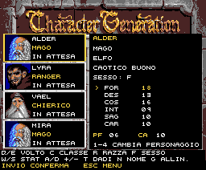

# Beholder MSX2 — demo VGA adattata a 16 colori

Demo giocabile per MSX2, realizzata con Fusion-C, SDCC e VS Code.
La ROM usa ora la grafica VGA originale di Eye of the Beholder convertita in
SCREEN 5: pareti, pavimento, soffitto, interfaccia, ritratti, porte, chiave e kobold.

È il primo livello dimostrativo del progetto, con una mappa originale 12×12.
Non è ancora la conversione completa del gioco e delle sue regole AD&D.

## Gioca online

**[Avvia il gioco in WebMSX](https://beholder-msx2.grandbuddy11.chatgpt.site/)** — senza installazione. Nel browser: PSG, SCC e FM-PAC. OPL4 FM disponibile con openMSX; WebMSX 6.0.8 emula solo OPL4 Wave.

## Introduzione e personaggi

Sei scene originali adattate a SCREEN 5 con dissolvenze, sottotitoli italiani e musica: logo Westwood, titolo, Waterdeep, consiglio, fogne e uscita bloccata. È una ricostruzione con immagini fisse, non la riproduzione completa delle animazioni PC. Invio avanza; Spazio o ESC saltano al menu. Il menu permette di creare il gruppo, usare quello predefinito o rivedere l'introduzione.

Creazione di quattro eroi con 44 ritratti originali, nome di otto caratteri, sei razze, sei classi singole, sesso, allineamento e sei caratteristiche. Limiti di razza/classe e restrizioni di allineamento sono applicati; punti vita e classe armatura sono calcolati. Le regole AD&D rimangono parziali: niente multiclasse o sistema completo di magie.

| Tasti nella creazione | Azione |
|---|---|
| 1–4 | Seleziona personaggio |
| Q / E | Ritratto precedente/successivo |
| R / C | Cambia razza/classe |
| F / G | Cambia sesso/allineamento |
| W / S | Seleziona caratteristica |
| A / D | Diminuisce/aumenta caratteristica |
| T | Ritira i valori, entro i limiti consentiti |
| N | Modifica nome; Invio conferma |
| Invio | Conferma eroe; dopo il quarto apre il riepilogo |
| ESC | Torna al menu |

Nel riepilogo, 1–4 riaprono un eroe; Invio entra nel dungeon. P durante il gioco mostra le schede senza azzerare lo stato. F2 riapre il frontend e prepara un nuovo gruppo.

## Audio originale

Musica originale di Paul Mudra: Westwood Logo e Intro Part 1/2 nella introduzione, Character Generation nei menu e nel dungeon, Ending Theme alla vittoria. PSG sempre disponibile, con rilevamento SCC, FM-PAC e FM OPL4. **U** musica on/off, **B** cambia chip. Per ascoltare subito le versioni con espansione usare Gioca SCC.cmd, Gioca FM-PAC.cmd o Gioca OPL4 FM.cmd. Dettagli, limiti e anteprime in `AUDIO.md`.

## Gioca

- Doppio clic su `Gioca.cmd`: avvia la ROM pronta in openMSX, senza richiedere Node.js.
- ROM pronta: `build/beholder-intro.rom`.
- Hardware: MSX2, 128 KB VRAM; cartridge **ASCII8 da 2 MB**.
- In openMSX selezionare C-BIOS_MSX2_EU e mapper ASCII8 se richiesto.
- `Apri progetto.cmd` apre il progetto nel VS Code della toolchain esistente.
- Ctrl+Shift+B compila; attività `MSX2: play` avvia il gioco.

Gli script usano la toolchain già presente in:
`C:\Users\Andrea\Documents\Codex\2026-10-27\cr\outputs\eagle-nest-msx`.
Su un'altra macchina impostare `MSX_KIT` alla cartella con `tools/sdcc`,
`tools/openmsx` e `vendor/fusion-c/Working Folder/fusion-c`. Solo per ricompilare serve Node.js
per la conversione degli asset. Lo script cerca Node nel PATH, nella cache locale di Codex e in Program Files; è possibile specificare NODE_EXE. SDCC verificato: 4.6.0 #16555.
Per IntelliSense aprire VS Code con MSX_KIT impostata nell'ambiente.

## Comandi

| Tasti | Azione |
|---|---|
| W / freccia su | Avanza |
| S / freccia giù | Indietreggia |
| A / D | Passo laterale |
| Q / E, oppure frecce sinistra/destra | Ruota di 90 gradi |
| Spazio | Attacca il nemico nella casella davanti |
| H | Usa una delle due pozioni di cura |
| F | Apri la porta davanti al gruppo |
| M | Mostra/nascondi la mappa completa di debug |
| R | Ricomincia il dungeon con il gruppo scelto |
| P | Consulta le schede individuali |
| F2 | Torna a introduzione e menu |
| ESC | Termina e riavvia la cartridge |

Un comando per pressione: rilasciare il tasto prima del successivo.
Il combattimento di questa demo procede a comandi: il kobold reagisce agli attacchi
andati a segno. Le quattro barre mostrano i punti vita individuali dei personaggi scelti. La forza del combattente determina il danno; il kobold contrattacca sui primi due eroi vivi. Una pozione ripristina i punti vita del gruppo. Il gruppo predefinito parte con 36 PF complessivi e sconfigge il kobold in tre colpi.

## Obiettivo

Superare il kobold, raccogliere la chiave, trovare e aprire la porta e raggiungere
l'uscita. La vittoria ferma il movimento; R permette di ricominciare.

Partenza (1,10), direzione nord. Kobold (1,8), chiave (1,7), porta (6,1), uscita (10,1).
Gli oggetti si raccolgono entrando nella loro casella. La chiave compare sul pavimento
quando è vicina e davanti al gruppo. Il nemico è visibile fino a tre caselle.

Percorso completo verificato (Spazio è indicato con HIT):
`W HIT HIT HIT W W E W W Q W W W W E W W W Q W F W E W W W W`

## Grafica e architettura

- SCREEN 5: 256×212, una palette condivisa di 16 colori nella gamma RGB333 MSX2.
- Le sorgenti VGA restano in `assets/source`; gli SHA-256 sono nel manifest generato.
- Ricostruzione delle vere pareti e del pavimento da BRICK.VCN/BRICK.VMP:
  1.575 tile originali, 111 viste distinte del labirinto dimostrativo.
- Quantizzazione della palette calcolata sulla grafica del livello e dell'interfaccia.
- Viste precalcolate e compresse RLE nella MegaROM ASCII8; nessun browser o PC
  effettua il rendering mentre si gioca: lo Z80 carica le viste dalla cartridge.
- Decompressione Z80 direttamente nella VRAM nascosta (pagina 1).
- Mostri, porte e chiave sono aggiunti con copie VDP trasparenti; la vista completa
  viene poi copiata sullo schermo con HMMM. Il lento rendering a linee è stato rimosso.
- Codice e costanti nei primi 24 KB fissi (4000–9FFF); asset nella finestra A000–BFFF, registro 7800h.
- I moduli C Fusion-C usati sono ricompilati con ABI stack SDCC 0.
- Helper aritmetici locali con ABI coerente e lettura della matrice tastiera via PPI.

Per cambiare grafica o mappa modificare le sorgenti o `assets/map.json` e ricompilare.
Il generatore verifica anche il round-trip di tutti i flussi RLE. Le dimensioni del
labirinto e le coordinate degli oggetti sono ancora fissate per questo livello.

## Verifica

`powershell -NoProfile -ExecutionPolicy Bypass -File scripts/verify.ps1`

24 controlli eseguiti in openMSX/C-BIOS MSX2, incluso un percorso completo dalla
partenza alla vittoria usando soltanto i comandi del gioco. I controlli isolati di
porta e morte usano fixture nella RAM; il percorso completo finale non le usa.

Verificati: avvio, SCREEN 5, movimento, collisioni, nemico che blocca il passaggio,
attacchi e contrattacchi, consumo della pozione, sconfitta del nemico, raccolta chiave,
mappa, porta chiusa/aperta, uscita, blocco dopo vittoria/morte e ripartenza.

Risultati: `build/checks.txt`, `build/verification.txt` (`failures=0`).
Le fixture dipendono dal layout dei primi undici byte dei globali: aggiornarle
quando cambia il layout RAM.

Le quattro PNG `preview.png`, `combat-preview.png`, `door-preview.png` e
`map-preview.png` sono ricostruite dai dati VRAM e dalla palette del VDP emulato.
Non sono mockup. L'esportazione diretta evita gli screenshot neri della finestra
nascosta di openMSX riscontrati in questa sessione.

## Ancora da sviluppare

Mappe e trigger originali, movimento e animazione dei mostri, combattimento in tempo
reale con regole AD&D, schede individuali, inventario, magie e salvataggi.
Vedi `ASSET-SOURCES.md` per provenienza delle risorse e degli strumenti.

Verifica frontend: scripts/verify-front.ps1, 29 controlli su intro completa, menu, creazione, modifica e trasferimento nel dungeon. Risultati in build/front-checks.txt e build/front-result.txt.

